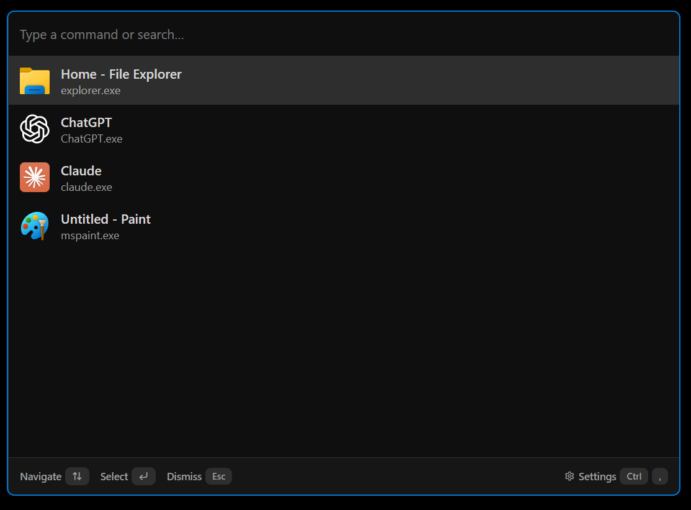
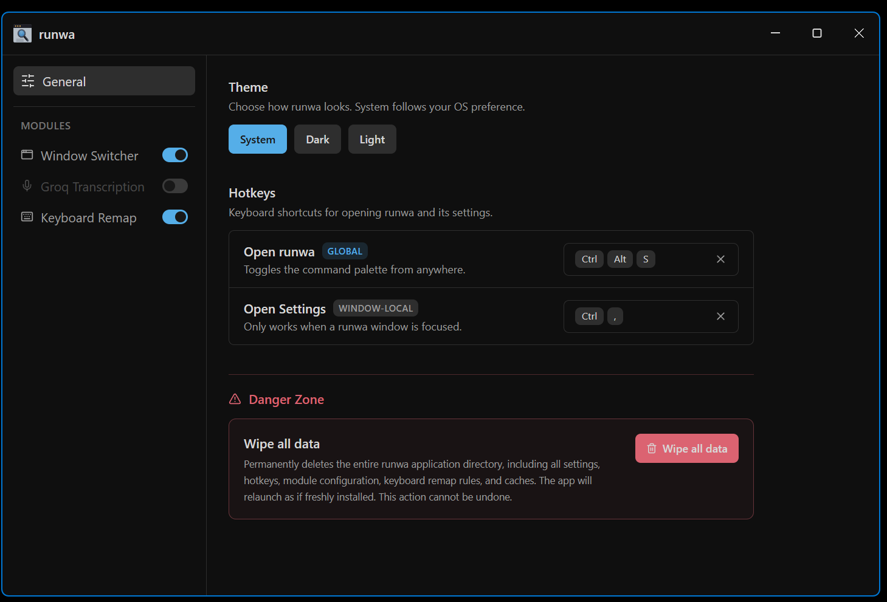

# Runwa

A keyboard-driven command palette launcher for Windows and macOS, inspired by [PowerToys Command Palette](https://learn.microsoft.com/en-us/windows/powertoys/command-palette/overview). Each feature is a module with its own global hotkey, settings page and on/off switch.



<details>
<summary>More screenshots</summary>



</details>

## Command palette

The palette is one small window that opens on a single module at a time: App Search, Window Switcher, Command Palette, User Commands or Flashcards. There is no combined "search everything" screen and no shared "open palette" hotkey; every module has its own.

- **Direct-launch hotkeys.** Each module with a palette view has a global hotkey, rebindable or clearable in Settings. Defaults: `Ctrl+Alt+Super+A` App Search, `Ctrl+Alt+Super+W` Window Switcher, `Ctrl+Alt+Super+P` Command Palette, `Ctrl+Alt+Super+U` User Commands, `Ctrl+Alt+Super+F` Flashcards. A hotkey must include a regular key; modifier-only chords are not accepted.
- **Second press.** Pressing the hotkey again closes the palette. In Window Switcher it switches to the previous window instead.
- **Opening from Keyboard Remap.** An `open_module` rule opens a module exactly as its hotkey would. The module's settings page shows which remap chords open it.
- **Search.** App Search, Window Switcher and User Commands rank matches by where the typed characters land (word starts first, so acronyms work). App Search and Window Switcher fall back to a typo-tolerant search when nothing matches. Command Palette and Flashcards match by substring.
- **Keys.** `Up` / `Down` move, `Enter` runs, `Esc` closes. The first nine results are numbered: a digit runs that result and `Alt`+digit types the digit (a setting swaps the two).
- **Input language.** By default the palette switches the system input language to English when it opens (the layout must already be installed).
- **Window.** The palette can be dragged and resized; its position and size are remembered.

### Aliases

An alias is a short string attached to one result. Typing it exactly runs that result without pressing Enter.

- Available on App Search, Command Palette and User Commands rows.
- Set with `Ctrl+K` → *Set alias…* (or *Change alias…*). Saving an empty alias removes it.
- Shown as a chip on the row. Aliases are stored lowercase.
- App Search has a setting for what an exact alias match does: run the app, or only move it to the top.
- `,` is the default alias for *Open settings*.

### Action menu

`Ctrl+K` (or a right-click) opens a menu of actions for the highlighted row. The entries depend on the row.

- *Set alias…* — rows that support aliases.
- *Show in file explorer* — rows backed by a file: apps, windows, flashcard decks.
- *Always run as administrator* / *Stop running as administrator* — App Search rows with a file path, Windows only.
- *Ignore this window* and *Ignore all <process> windows* — Window Switcher rows.
- *Disable remapping in fullscreen* / *Re-enable remapping in fullscreen* — Window Switcher rows, Windows only.
- *Reset deck data…* — Flashcards deck rows, after a confirmation.

## Modules

Modules are switched on and off in Settings. On a fresh install App Search, Window Switcher, Command Palette, User Commands, Flashcards, Keyboard Remap, Auto Dark Mode and Notifications are on; Hotstrings, Ulanzi and Groq Transcription are off.

### App Search

Launches installed applications. The app list and its icons are built in the background at startup.

- Sources: Start Menu shortcuts on Windows; `.app` bundles in `/Applications`, `/System/Applications` and `~/Applications` on macOS.
- Windows: optional Store / UWP apps (on by default) and Desktop shortcuts (off by default).
- macOS: helper apps whose name starts with a dot are hidden by default.
- Additional folders, one per line, scanned up to three levels deep.
- On Windows, `Enter` on an app that is already running focuses its window; `Alt+Enter` starts a new instance.
- `Ctrl+R` rescans the app list.

### Window Switcher

Lists open windows and focuses the selected one. Windows are matched by title and by process name.

- The list is ordered most recent first, so the second row is the previously focused window; pressing the hotkey twice switches to it, including between two windows of the same app.
- `Tab` switches between windows of the current virtual desktop and windows of all desktops.
- `Ctrl+D` (`Cmd+D` on macOS) closes the highlighted window without leaving the list.
- Rows show the window's own icon, falling back to the executable's icon.
- Ignore list: hide a window, or every window of a process, from the action menu. Rules are reviewed, added (with `*` wildcards) and removed in the module's settings.
- Options: hide Windows system surfaces (on by default); focus a window immediately when the search narrows to one match (off by default).
- macOS needs Screen Recording permission to read window titles; without it rows show the process name.

### Command Palette

Built-in system commands and the user's own commands in one list. Every built-in command except *Open settings* has a checkbox in the module's settings to hide it.

- Settings: *Open settings*, *About runwa*, and one *Open <Module> settings* entry per module.
- Window control: *Maximize window*, *Minimize window*, *Restore window*, applied to the window that was focused before the palette opened.
- Power: *Shut down* and *Restart* (both ask for confirmation), *Sleep*, *Hibernate* (not offered on macOS).
- Themes: *Themes on schedule* and *Toggle theme*, listed while Auto Dark Mode is on.
- Keyboard Remap: *Edit Keyboard Remap rules* and *Reload Keyboard Remap rules*, listed while Keyboard Remap is on.
- User Commands: the user's commands, then *Create user command for <app>* and *Edit user commands*, listed while User Commands is on.

### User Commands

Named actions created by the user. They appear in Command Palette and in the module's own search, which lists the commands of the app in front.

- **Shell commands** take a command line in the platform shell's syntax. They run detached from the home folder through `cmd.exe` on Windows or `/bin/sh` on macOS. Output is not captured. They run with Runwa's permissions, including elevation when *Run as administrator* is on.
- **Keystroke commands** press a shortcut in the window that was focused before the palette opened. Steps are separated by commas, up to eight: `Ctrl+Alt+L`, `Alt+Space, R`, `CmdOrCtrl+Shift+P`. The syntax is checked when the command is saved.
- **Scope.** A command with an empty *Applies to* field is global. Otherwise it is listed only while the named app is the one in front. The field is matched, case-insensitively and with `*` wildcards, against the focused app's identity, for example `idea64.exe` on Windows, `IntelliJ IDEA` on macOS, or `*idea*`. The field suggests the apps that are currently open.
- **Module hotkey.** Opens a search over the commands scoped to the app in front; `Tab` adds the global ones. If the app has none, it opens on the global commands. If there are no commands at all, a notification says so.
- **Creating from the palette.** *Create user command for <app>* opens a form in the palette with the app scope already filled in. The new command is selected in the list afterwards.
- **Aliases.** Set in Settings or with `Ctrl+K` on the row. An alias must be unique within one app scope, and different apps can reuse the same one. An app-scoped command wins over a global command with the same alias.
- **Settings.** Add, edit in place and remove commands; the list is grouped by app. Editing keeps the command's identity and alias. Names must be unique within one app scope.
- **Storage.** Commands live in a JSON file that the *Edit* button (or *Edit user commands*) opens in the system editor. Malformed entries are skipped.
- A fresh install includes three removable example commands for the current platform.
- Limits: 200 commands; name 100 characters, action 4096, scope 512, alias 64.

### Flashcards

Multiple-choice quizzes over Markdown decks, with spaced repetition. Selecting a deck turns the palette window into the quiz.

- One `.md` file per deck. `# Title` is optional, `## Question` starts a card, `- [ ]` / `- [x]` lines are the options, and `> text` is an optional explanation. If the file contains `###` headings, `##` becomes a topic and `###` a question.
- A card needs at least two options and exactly one correct option. Other cards are reported as warnings and skipped.
- SuperMemo-2 scheduling per card. `Enter` on a deck reviews the cards that are due; `Ctrl+Enter` crams the whole deck.
- Card order and option order are shuffled for each session.
- Quiz keys: `1`–`9` answer, `Enter` reveals the answer, `Space` / `Right` / `W` go to the next card, `Left` / `Backspace` go back, `Esc` returns to the deck list.
- Deck rows show the number of due cards and how many cards are mature (review interval of 21 days or more).
- Settings: choose or reset the decks folder (default is `decks` in the settings folder), open it, reload decks.
- Settings also keep an editable prompt file for generating decks with an LLM, with Copy, Edit and Reset buttons.

### Keyboard Remap

A system-wide tap/hold remapping layer driven by a YAML rules file, implemented in the Rust native addon for Windows and macOS. The default rules include CapsLock as Escape on tap and Ctrl on hold, and Space as a layer key.

- Each top-level key in the file is a trigger with `on_tap` and `on_hold`. `on_hold` is either a modifier (a transparent layer) or a list of per-key rules. Rules can be limited to one OS with `os:`.
- Rule actions: `to_hotkey`, `switch_to_workspace`, `move_to_workspace`, `alternate_workspace`, `change_language`, `close_window`, `open_module`, `shell`, `toggle_capslock`.
- A `keys: [any]` rule sets the modifier used for keys of a layer that have no rule of their own.
- Settings show the file path, *Edit* and *Reload* buttons, and the parsed triggers. Reloading needs no restart, and a notification reports the result. A file that fails to parse leaves the previous rules active.
- The tray icon can show the current virtual desktop number (on by default; on macOS the number stays at 1).
- Option: a `switch_to_workspace` rule for the desktop you are already on jumps back to the previous desktop.
- Windows: individual apps can be excluded from remapping while they are fullscreen, from the Window Switcher action menu. The list is managed in settings.
- macOS needs Accessibility permission.

### Hotstrings

Expands typed abbreviations into longer text in any application. Rules are edited as plain text in the module's settings, one per line.

- `trigger -> replacement` erases the trigger and pastes the replacement, then restores the previous clipboard text.
- `trigger => replacement` erases the trigger, puts the replacement on the clipboard and shows a "Press Ctrl+V to paste" notification (⌘V on macOS), for fields that ignore synthetic input.
- Triggers are case-sensitive. A trigger that starts with a letter or digit does not fire inside a longer word.
- Lines starting with `#` are comments.
- Typed keys are read with a US QWERTY mapping.
- Rule changes apply immediately.

### Auto Dark Mode

Switches the Windows or macOS system appearance between light and dark, manually or at two local times each day.

- Modes: *Manual* (the default) and *Scheduled*. Default times are 07:00 for light and 19:00 for dark.
- *Toggle theme* in Command Palette switches the appearance and sets the mode to Manual; *Themes on schedule* sets it back to Scheduled and applies the theme for the current time.
- Windows: optionally sets a solid desktop background colour for each theme.

### Ulanzi

Shows the active Ulanzi Studio profile in the notification strip when it changes, for decks without a screen. Profiles are read from Ulanzi Studio's own data; nothing is typed by hand.

- Per-profile display: *Brief* (1.5 seconds), *Sticky* (until another profile becomes active), *Hidden*, or automatic.
- Automatic means sticky for a profile that follows no app and brief for profiles bound to an app.
- Each profile can be given a label shown instead of its name.

### Groq Transcription

Voice-to-text through Groq's Whisper API, driven by a hotkey only (default `Ctrl+Alt+Super+D`). The transcript is put on the clipboard and pasted into the focused window.

- Modes: push-to-talk (hold the hotkey) or toggle (press to start, press to stop). Push-to-talk falls back to toggle when the native key hook is unavailable.
- Models: Whisper Large v3 and Whisper Large v3 Turbo.
- Language hint: Auto, English, Russian, German, Spanish or French.
- Optional biasing prompt for names and jargon.
- Requires a Groq API key, stored locally in the settings file.
- The notification strip shows "Listening…" and "Transcribing…" while it works.

### Notifications

A strip at the edge of the screen that every module reports through: the active Ulanzi profile, recording state, a reloaded config, a hotstring waiting on the clipboard. Scripts can show a message in it with the `runwa-notify` command.

- Four looks: *Plate* (the default, a coloured plate), *Bar*, *Tag* and *Line*.
- Six positions: bottom (the default), top and the four corners. The strip appears on the display the pointer is on.
- Default duration for notifications that do not set their own: 2, 3, 4 (the default), 6 or 10 seconds.
- The strip shows one notification at a time, the newest. When it expires, an earlier one that is still active returns.
- Errors and update notices (Groq Transcription errors, "update ready") go to the system notification centre by default, or to the strip.
- Notifications sent from the console go to the strip (the default), the system notification centre, or both.
- Turning the module off silences the strip, including ongoing statuses, and stops reading console notifications. Errors and update notices routed to the system notification centre still appear.
- A *Test* button in settings shows a sample notification.

**`runwa-notify`**

```text
runwa-notify --text "Finished in 74 s" [--title "Build"] [--duration 4000]
             [--tone neutral|error|success] [--source build]
             [--to runwa|system|both]
```

- `--text` is required. `--duration` is in milliseconds.
- A later notification with the same `--source` replaces the earlier one.
- `--to` overrides the module's console setting for one call.
- The command only writes a small JSON file into the `notify-inbox` folder inside Runwa's settings folder, which Runwa watches. Nothing is launched, so it works from a non-elevated shell while Runwa runs as administrator.
- Runwa must be running with the Notifications module on.
- It ships as `runwa-notify.cmd` on Windows and a `runwa-notify` shell script on macOS. It is not added to `PATH`; the module's settings show the full path and a ready-to-paste example, each with a Copy button.
- Limits: title 80 characters and text 300 (longer ones are cut), duration between 1 and 30 seconds, source up to 40 characters from `A-Z a-z 0-9 _ . -`, at most 10 notifications per 10 seconds. A request file over 8 KB, one that does not parse, or one over the rate limit is dropped silently.

## Settings

A separate window with a sidebar: General, the modules grouped as Searches, Keyboard and Other, and About. It opens from the tray menu, from *Open settings* in Command Palette, or by launching Runwa while it is already running.

- **General.** Theme (System, Dark, Light) and, for the light theme, its background: White (the default), Paper, Paper soft, Steel or Stone; palette options (`Alt`+digit to run a result, switch to English on open); *Start at login*; *Run as administrator* (Windows); *Wipe all data*, which deletes all Runwa data and relaunches the app.
- **Module pages.** Each module has an on/off switch in the sidebar and a page with its direct-launch hotkey (record, clear, reset to default) and its options.
- **Switched-off modules.** The page of a module that is off is shown locked: a notice with a *Turn on* button, and the settings below readable but not editable.
- **About.** App version, bedware UI version, a link to the settings folder, and the update status with a *Check for updates* / *Install now* button.
- macOS permission status is shown on the pages of the modules that need it.

### Themes

Runwa has a dark and a light theme from the bedware design system and can follow the OS.

- *System* follows the OS appearance, *Dark* and *Light* pin it. The notification strip always follows the OS.
- The light theme is white. Its background can be changed to warm paper (two shades), cool steel or grey stone; the choice applies to the palette, Settings and the notification strip whenever the theme on screen is light, including *System* on a light OS.
- Selected and active elements are yellow plates with black text in both themes.

### Vim keys

The Settings window can be driven entirely from the keyboard, using the form keys of `@bedware/ui/vim-form`. A hint bar at the bottom shows the current mode.

- `j` / `k` (also `Down` / `Up`, `Tab` / `Shift+Tab`) move the cursor between controls; `gg` and `G` jump to the first and last; `Ctrl+D` / `Ctrl+U` move half a page.
- `J` / `K` (also `gt` / `gT`) go to the next and previous section, in sidebar order.
- Every control and sidebar entry has a letter label; typing the label jumps to it.
- `h` / `l` (also `Left` / `Right`) change a value; `Enter` activates a control; `Space` toggles it.
- `i` starts typing in a text field (INSERT mode). `Esc` leaves the field; a second `Esc` closes the window.
- In list rows, `e` edits the row and `dd` removes it.
- `?` shows the full key table.
- While a shortcut is being recorded or a dialog is open, keys go to it instead.

## Running elevated on Windows

Runwa can run as administrator so that its global hotkeys and keyboard remap keep working while an elevated window is in front. Apps started from Runwa do not inherit that elevation.

- *Run as administrator* is a toggle in Settings → General, off by default. Manual launches then show a UAC prompt.
- Combined with *Start at login*, Runwa registers a scheduled task that starts it elevated at login without a prompt.
- While Runwa is elevated, App Search starts apps as the regular desktop user, and files and folders (rules file, decks folder, commands file) open through Explorer.
- A single app can be marked *Always run as administrator* from the action menu; marked rows carry a shield badge.
- User Commands shell commands are the exception: they run with Runwa's own permissions.

## Tray

Runwa keeps running in the background with a tray icon and has no main window.

- Menu: Settings, Check for updates, About, Quit.
- macOS adds *Reset CapsLock HID remap*, a recovery item for a CapsLock mapping left behind by a crash.
- The icon can show the current virtual desktop number (see Keyboard Remap).

## Updates

Packaged builds update themselves from the project's GitHub releases.

- Checks run at launch and every four hours; *Check for updates* in the tray menu or on the About page runs one on demand.
- The update downloads in the background. A notice says when it is ready.
- It installs on the next quit on Windows, or immediately with *Install now* on the About page.
- macOS builds are ad-hoc signed; there the update is downloaded as a zip and swapped in when you choose *Install now*.
- Updates are disabled in development runs.

## Tech stack

Electron 41 · React 19 · TypeScript 5 (strict) · electron-vite 5 / Vite 7 · Tailwind CSS v4 · Zustand 5 · Fuse.js 7 · Rust native addon (napi-rs) · uiohook-napi · electron-store · electron-updater

UI components come from the bedware design system, the `@bedware/ui` package.

## Getting started

```bash
npm install
npm run build:native   # compile the Rust native addon
npm run dev
```

- Requires a Rust toolchain for the `native/` crate.
- `npm run typecheck` runs the TypeScript check.
- A development run is named "Runwa Dev" and keeps its data in a separate folder, so it can run next to an installed copy.

## Building

```bash
npm run dist:win    # Windows NSIS installer (x64)
npm run dist:mac    # macOS dmg and zip (x64 and arm64)
npm run dist:linux  # Linux AppImage
```

Output goes to `release/`. The native addon (window list, keyboard remap, elevation) is implemented for Windows and macOS only.

## Releasing

A release is a `v<version>` tag on `main`; GitHub Actions builds the installers from the tag and publishes the GitHub release that installed copies update from.

```bash
npm run release              # tag the pushed tip of main and push the tag
npm run release -- --dry-run # show what would be tagged, change nothing
```

- The version is not chosen by hand: a pre-commit hook bumps the patch version on every commit.
- The commit must already be pushed to `origin/main`, and its tag must not exist yet.

### Local install loop

`scripts/prod-iter.sh` (macOS) and `scripts/prod-iter.ps1` (Windows) commit, build while the installed app keeps running, reinstall it, relaunch it and push. They run no tests and no typecheck.

- Both take an optional commit message.
- On Windows, where the installed app runs elevated, `scripts/install-prod-iter-task.ps1` creates a scheduled task once (from an elevated shell), and `scripts/prod-iter-run.ps1` starts it from a normal shell and reports the result.
